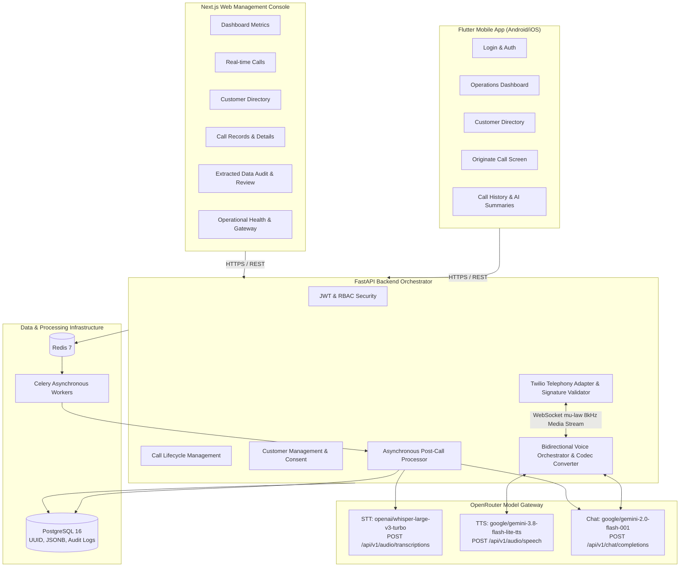

# AI-Powered Call Center POC

An enterprise-grade, end-to-end Proof of Concept (POC) for an AI-powered voice call center capable of conducting real two-way conversations in **Egyptian Arabic** and **English**, streaming audio through telephone networks, transcribing calls with Whisper Large V3 Turbo, and extracting structured customer insights into PostgreSQL.

---

## 1. System Architecture



---

## 2. Technology Stack & Verified AI Models

| Component | Technology | Specification / Details |
|---|---|---|
| **Speech-to-Text (STT)** | `openai/whisper-large-v3-turbo` | OpenRouter `/api/v1/audio/transcriptions` (base64 WAV, verbose JSON metadata) |
| **Text-to-Speech (TTS)** | `google/gemini-3.8-flash-lite-tts` | OpenRouter `/api/v1/audio/speech` (MP3/PCM audio stream, multilingual including Egyptian Arabic) |
| **Conversation LLM** | `google/gemini-2.0-flash-001` | OpenRouter `/api/v1/chat/completions` (Conversational reasoning & structured JSON extraction) |
| **Telephony** | Twilio Programmable Voice | Bidirectional WebSocket Media Stream (`mu-law` 8kHz 20ms chunks), TwiML, Webhooks |
| **Backend API** | FastAPI / Python 3.10+ | Async SQLAlchemy 2.0, Pydantic v2, JWT Security, Celery background tasks |
| **Database** | PostgreSQL 16 | UUID keys, full foreign keys, timestamps, JSONB, audit logs, Alembic migrations |
| **Web Dashboard** | Next.js 13 / TypeScript | Tailwind CSS, responsive operations console, extraction review, audit corrections |
| **Mobile App** | Flutter 3.3+ / Dart | Cross-platform (Android/iOS), customer directory, outbound call trigger, call history |

---

## 3. Getting Started & Running Locally

### Step 1: Environment Variables
Copy `.env.example` to `.env`:
```bash
cp .env.example .env
```
Fill in your configuration:
- `OPENROUTER_API_KEY`: Your OpenRouter API key for Whisper and Gemini TTS.
- `TWILIO_ACCOUNT_SID`, `TWILIO_AUTH_TOKEN`, `TWILIO_PHONE_NUMBER`: (Optional) Required only for real public PSTN phone calls. If absent, set `TELEPHONY_PROVIDER=simulated` to run in-app test mode.

### Step 2: Start Infrastructure with Docker Compose
```bash
docker compose up -d postgres redis
```

### Step 3: Run Database Migrations & Seed Data
```bash
cd services/api
alembic upgrade head
python ../../scripts/seed.py
```
*Default Seed Credentials:*
- **Admin**: `admin@callcenter.poc` / `Admin123!`
- **Operator**: `operator@callcenter.poc` / `Operator123!`
- **Viewer**: `viewer@callcenter.poc` / `Viewer123!`

### Step 4: Start FastAPI Backend
```bash
cd services/api
uvicorn app.main:app --host 0.0.0.0 --port 8000 --reload
```
- API Docs: [http://localhost:8000/api/docs](http://localhost:8000/api/docs)
- Health Check: [http://localhost:8000/api/v1/health](http://localhost:8000/api/v1/health)

### Step 5: Start Celery Worker (for Post-Call Transcription)
```bash
cd services/api
celery -A app.workers.celery_app worker --loglevel=info -P solo
```

### Step 6: Start Next.js Web Console
Node dependencies are hoisted outside `apps/web` into the root `node_modules` via npm workspaces. Run from root or `apps/web`:
```bash
npm run dev
# or:
npm run web:dev
```
Open [http://localhost:3000](http://localhost:3000) in your browser.

### Step 7: Run Flutter Mobile App
```bash
cd apps/mobile
flutter run
```

---

## 4. Demonstrating Inbound & Outbound AI Calls

### Demonstration A: Outbound Call Initiation
1. Log in to the Web Console ([http://localhost:3000](http://localhost:3000)) or Mobile App with `operator@callcenter.poc` / `Operator123!`.
2. Navigate to **Call Operations** and click **Originate Outbound Call**.
3. Select an existing customer or enter an international phone number (e.g., `+201234567890`).
4. Select the language (`Egyptian Arabic` or `English`) and mode (`Simulated` or `Real`).
5. Click **Start Call**.
6. When answered, the AI assistant greets the customer using the configured language and conducts a natural conversation.
7. Upon hang-up, the call duration is recorded, audio is submitted to Whisper Large V3 Turbo for transcription, and structured data is extracted.

### Demonstration B: Inbound Customer Call Flow
1. Expose your local backend port `8000` via ngrok: `ngrok http 8000`.
2. In your Twilio Voice Phone Number settings, set the Webhook URL to:  
   `https://<your-ngrok-domain>/api/v1/webhooks/telephony/incoming` (HTTP POST).
3. Call your Twilio phone number from any phone.
4. The caller hears the AI introduction and can converse naturally in Arabic or English.
5. All utterances are processed sequentially through live STT, Gemini LLM, and Gemini Flash-Lite TTS streamed back in `mu-law` 8kHz.
6. The completed transcript, summary, and action items appear automatically on the **Post-Call Extraction Review** page in the web dashboard.

---

## 5. Automated Tests

Run backend unit and integration tests:
```bash
cd services/api
python -m pytest tests -v
```
All 14 unit and integration tests pass cleanly:
- Authentication & JWT token issuing / refresh / role-based access.
- Customer creation, duplicate telephone number validation, search, and update.
- Health endpoints and AI provider connectivity.

---

## 6. GitHub Integration & DevOps Automation

### A. Connect to your Remote GitHub Repository
```bash
# Add your GitHub repository remote URL:
git remote add origin https://github.com/YOUR_USERNAME_OR_ORG/YOUR_REPO_NAME.git

# Push your main branch to GitHub:
git push -u origin main
```

### B. CI/CD Workflows (`.github/workflows/`)

| Workflow | File | Trigger | Purpose |
|---|---|---|---|
| **Continuous Integration** | `.github/workflows/ci.yml` | Push & PR to `main` / `develop` | Runs automated Python 3.10 tests with PostgreSQL & Redis test services, Next.js web build verification, and Flutter static analysis. |
| **Batch Operations** | `.github/workflows/batch-operations.yml` | `workflow_dispatch` & Cron (02:00 UTC) | On-demand or scheduled execution of batch jobs: backlog call post-processing, database migrations, seeding, or operational audits. |
| **Release Automation** | `.github/workflows/release.yml` | Tag push (`v*.*.*`) or Manual Dispatch | Builds production distribution packages (`callcenter_api_namecheap.zip` & `admin_portal_namecheap.zip`), creates GitHub Release with changelog, and publishes downloadable assets. |
| **Automated Deployment** | `.github/workflows/deploy.yml` | Published Release or Manual Dispatch | Multi-environment deployment (Staging/Production) supporting SSH/cPanel extraction or Docker Compose deployment with health check verification. |

### C. Managing Batches Locally & in CI/CD
A unified batch runner script is provided at `scripts/batch_runner.py`:
```bash
# Batch process up to 50 pending/unsummarized calls:
python scripts/batch_runner.py --batch-type process-calls --limit 50

# Run database migrations:
python scripts/batch_runner.py --batch-type migrate

# Seed operational data:
python scripts/batch_runner.py --batch-type seed

# Run health & external AI audit:
python scripts/batch_runner.py --batch-type audit
```

### D. Automated Release Management
To bump version, tag, and trigger the GitHub Release workflow:
```bash
# Bump semantic version (patch, minor, or major):
python scripts/create_release.py --bump patch --tag --push

# Or specify an exact version:
python scripts/create_release.py --version 1.1.0 --tag --push
```

### E. GitHub Secrets Reference
Configure these secrets in your repository settings (**Settings > Secrets and variables > Actions**):
- `OPENROUTER_API_KEY`: API Key for Whisper STT and Gemini TTS/Chat
- `DATABASE_URL`: PostgreSQL connection string (e.g., Neon / Supabase cloud database)
- `JWT_SECRET`: Random 32+ character string
- `SSH_HOST`: (Optional) Remote host IP/domain for automated deployment
- `SSH_USERNAME`: (Optional) Remote server SSH username
- `SSH_PRIVATE_KEY`: (Optional) Private SSH key for server deployment
- `HEALTH_CHECK_URL`: (Optional) URL to verify post-deployment (e.g., `https://api.yourdomain.com/api/v1/health`)

---

## 7. Google VPS (Ubuntu 24.04 LTS) Production Deployment

For full production deployment instructions, see [DEPLOYMENT_UBUNTU24.md](docs/DEPLOYMENT_UBUNTU24.md).

### Quick Deployment via Windows Batch Tool:
Run `deploy_google_vps.bat` to package and transfer to your Google VPS.

### Quick Deployment on Ubuntu 24.04 Server:
```bash
# 1. Run server preparation script (installs Docker, FFmpeg, UFW)
sudo bash infrastructure/scripts/setup_ubuntu24.sh

# 2. Configure environment
cp .env.example .env
nano .env

# 3. Deploy all services (PostgreSQL, Redis, API, Celery Worker, Web Nginx)
bash infrastructure/scripts/deploy.sh
```


